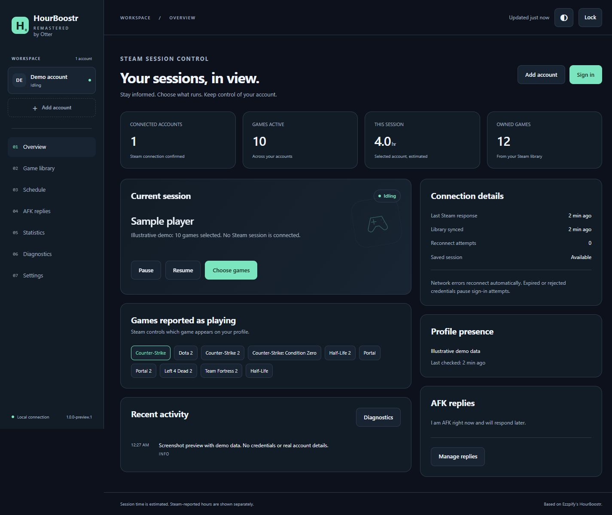
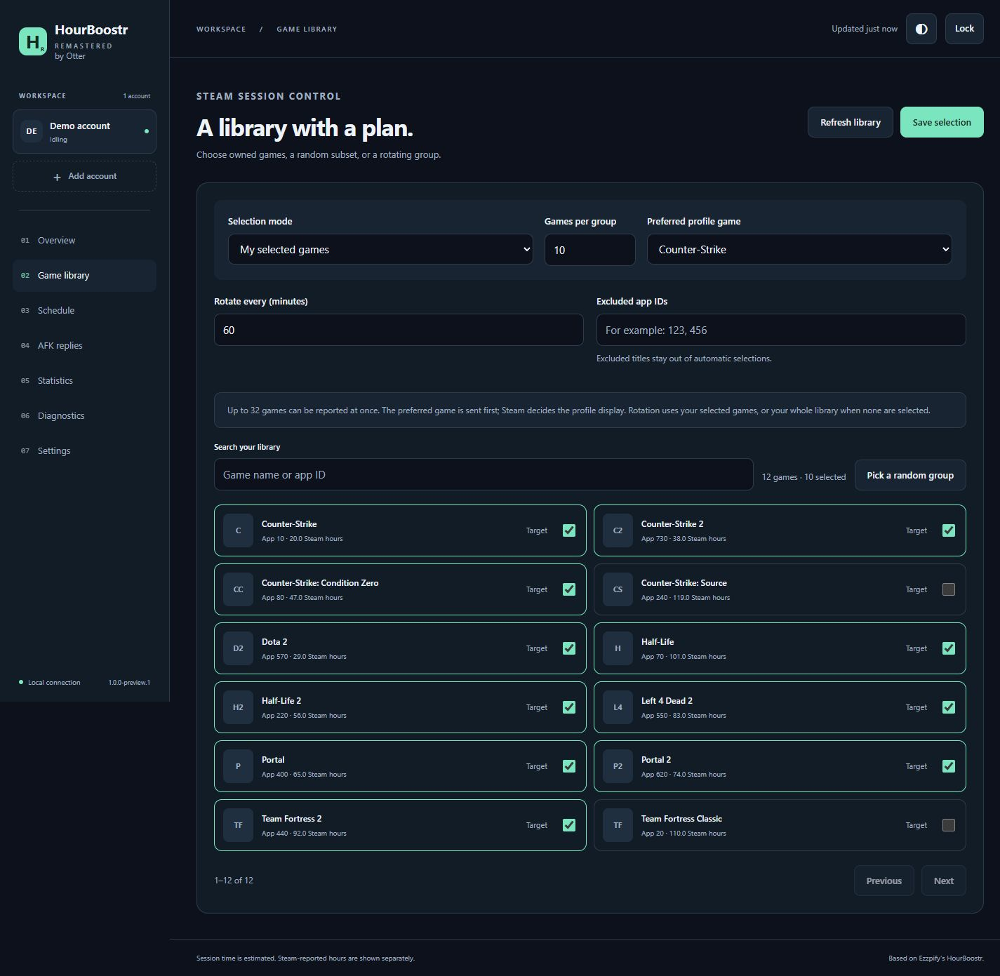
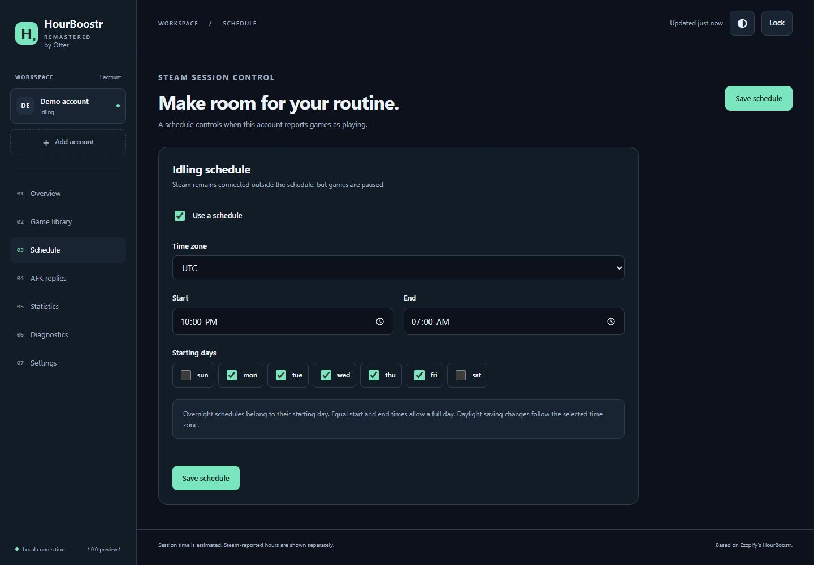
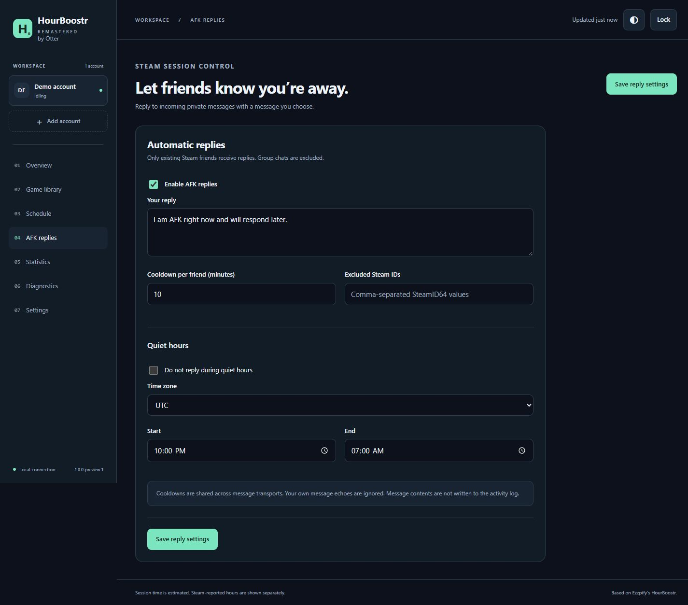
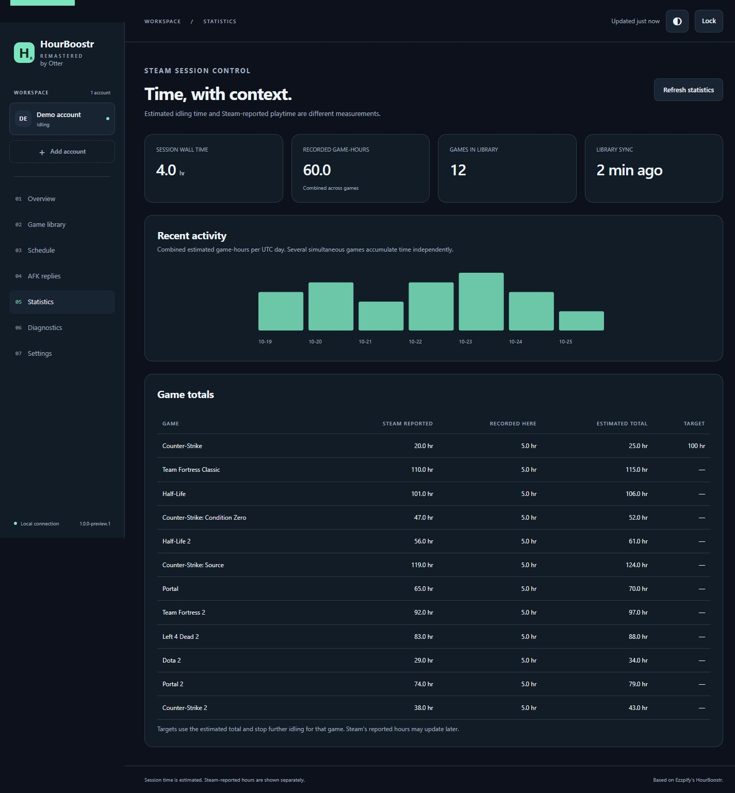

# HourBoostr Remastered by Otter

A self-hosted **Steam hour booster / Steam idler** with modern sign-in, a local dashboard, Windows tray controls, and a command-line interface. **HourBoostr Remastered by Otter** is an independent continuation of [Ezzpify/HourBoostr](https://github.com/Ezzpify/HourBoostr), distributed under GPL-3.0. The original source and commit history are preserved.

[Download preview](https://github.com/otter-supremacy/HourBoostr-Remastered/releases/tag/v1.0.0-preview.1) · [Complete tutorial](docs/TUTORIAL.md) · [Troubleshooting](docs/TROUBLESHOOTING.md) · [Credits](CREDITS.md) · [Otter on GitHub](https://github.com/otter-supremacy) · [Otter on Steam](https://steamcommunity.com/id/pornhub_sex5/)

**Looking for the older HourBoostr?** This project continues the Steam-client-style HourBoostr approach with a new .NET 10 application. The preserved [original README](legacy/README.md) describes HourBoostr and SingleBoostr. The remaster does not implement SingleBoostr's trading-card farming.



*Screenshots show the real dashboard with illustrative demo data, not a connected Steam account. They contain no real credentials or account details.*

## Start here

| Platform | Download / guide |
| --- | --- |
| Windows x64 | [Windows ZIP](https://github.com/otter-supremacy/HourBoostr-Remastered/releases/download/v1.0.0-preview.1/HourBoostr-Remastered-1.0.0-preview.1-win-x64.zip); extract, then open `HourBoostr.Desktop.exe`. [Windows tutorial](docs/TUTORIAL.md#windows-desktop) |
| Linux x64 / VPS | [Linux x64 ZIP](https://github.com/otter-supremacy/HourBoostr-Remastered/releases/download/v1.0.0-preview.1/HourBoostr-Remastered-1.0.0-preview.1-linux-x64.zip). [Linux and VPS tutorial](docs/TUTORIAL.md#linux-and-vps) |
| Linux ARM64 | [Linux ARM64 ZIP](https://github.com/otter-supremacy/HourBoostr-Remastered/releases/download/v1.0.0-preview.1/HourBoostr-Remastered-1.0.0-preview.1-linux-arm64.zip); use the Linux guide. Native ARM64 execution remains unverified |
| Build / Docker | [Source build](docs/TUTORIAL.md#build-from-source) · [Docker](docs/TUTORIAL.md#docker-on-linux) |

This is a **preview release**. Password/Guard sign-in, saved-session recovery, idling controls, and AFK delivery were tested on Windows. QR approval, playing-elsewhere overlap, simultaneous live accounts, and native Linux/ARM64/container execution still have verification gaps. See the [feature matrix](docs/FEATURE-MATRIX.md).

## What changes from classic HourBoostr?

Classic HourBoostr already supported multiple accounts and idling without installing the Steam client. Those ideas belong to the original project. The remaster adds the following controls around that workflow:

| Area | Remaster advantage |
| --- | --- |
| Sign-in | Modern SteamKit authentication, password/Steam Guard prompts, a QR challenge flow, and explicit authentication-error states |
| Everyday use | A local dashboard, account controls, dark/light themes, and a CLI |
| Windows | A desktop window, tray icon, minimize/close-to-tray, and opt-in Windows sign-in startup directly in the tray |
| Selecting games | Search the owned library, select games manually, exclude titles, choose random groups, or rotate groups |
| Session planning | Per-account time-zone schedules, overnight windows, and estimated-hour targets |
| Visibility | Per-game estimates, daily charts, separate Steam-reported minutes, and connection status |
| AFK messages | Private-friend replies with configurable cooldowns, quiet hours, exclusions, and echo suppression |
| Friend requests | Opt-in acceptance of pending/new incoming individual requests, with spacing and bounded retries |
| Credentials | No saved passwords/Guard codes; separate session files; Windows DPAPI or owner-only Linux files |
| Recovery | Reconnection, Steam health probes, worker watchdogs, and platform startup/service tooling |
| Maintenance | Redacted diagnostics, automated tests, self-contained packages, checksums, staged updates, and managed rollback |

These are implementation differences, not speed or credited-hours benchmarks. Steam decides profile display and playtime accounting. Features and live-verification status are listed separately in the [feature matrix](docs/FEATURE-MATRIX.md).

<details>
<summary>More screenshots: library, schedules, AFK replies, and statistics</summary>






</details>

## Documentation

- [Complete tutorial: installation, sign-in, games, startup, VPS, Docker, updates and removal](docs/TUTORIAL.md)
- [Troubleshooting and frequently asked questions](docs/TROUBLESHOOTING.md)
- [Feature and verification matrix](docs/FEATURE-MATRIX.md)
- [Security and private data](SECURITY.md)
- [Contributing](CONTRIBUTING.md) and [credits](CREDITS.md)

## Features

- Password and Steam Guard sign-in, mobile approval, and QR-code sign-in through SteamKit2.
- Saved sessions with Windows DPAPI protection. Headless Linux uses owner-only files, without at-rest encryption.
- Multiple isolated account profiles, each with its own session, selection, schedule, and statistics.
- Owned-game search, manual selection, random groups, exclusions, preferred profile game, and group rotation.
- Estimated hour targets, time-zone-aware schedules, overnight windows, and daylight saving support.
- Automatic pauses while Steam reports the account is playing elsewhere.
- Private-friend AFK replies with cooldowns, exclusions, quiet hours, and echo suppression.
- Optional automatic acceptance of pending and new incoming friend requests, configurable per account in **Settings**. Only individual accounts with an incoming request are accepted; attempts are spaced and duplicate retries are limited.
- Worker reconnection, session health probes, watchdog recovery, and service/startup installers.
- A responsive local dashboard with dark/light themes, keyboard controls, and redacted diagnostics.
- A Windows desktop window with a system tray icon, minimize/close-to-tray controls, and optional startup directly in the tray.
- Explicit release checks, SHA-256-verified update staging, managed installation replacement, and rollback.

Steam controls its playtime accounting and which game is displayed on your profile. The app distinguishes its estimated counters from Steam-reported minutes. It does not guarantee uninterrupted hosting, account availability, a particular profile display, or a particular number of credited hours.

## Quick start from source

Install the [.NET 10 SDK](https://dotnet.microsoft.com/download/dotnet/10.0). No Steam client or game installation is required for this app to connect; your account must own the selected games.

1. Build the solution:

   ```sh
   dotnet restore HourBoostr.Remastered.slnx
   dotnet build HourBoostr.Remastered.slnx -c Release
   ```

2. Start the dashboard:

   ```sh
   dotnet run --project src/HourBoostr.Remastered -c Release --no-build -- serve
   ```

3. In a second terminal, open and pair the local dashboard:

   ```sh
   dotnet run --project src/HourBoostr.Remastered -c Release --no-build -- open
   ```

4. Add an account and sign in. Enter credentials only in the local dashboard or interactive CLI. Passwords and Steam Guard codes are not saved.
5. Open **Game library**, select owned games or choose a random group, and save. Accounts initially have no selected games.

The default dashboard is `http://127.0.0.1:3241`. Use the same `--data-dir` and `--port` for every command that controls an installation.

## Published packages

Extract a release into a dedicated directory. On Windows, run `HourBoostr.Desktop.exe` for the desktop window and tray controls. Keep it beside `HourBoostr.Remastered.exe` and the other package files. The desktop dashboard uses Microsoft's Edge WebView2 Runtime; if it is missing, the launcher offers the browser dashboard while the worker continues in the tray. The self-contained packages do not require a separate .NET runtime.

For a headless dashboard, run `HourBoostr.Remastered.exe serve` on Windows or `./HourBoostr.Remastered serve` on Linux. In a second terminal, run the same executable with `open` to pair the browser.

### Windows startup and tray

1. Open `HourBoostr.Desktop.exe` and go to **Settings → Windows startup and tray**.
2. Enable **Start with Windows**. This adds a current-user Windows sign-in entry. It always passes `--start-minimized`, so no dashboard window opens at sign-in. Administrator access and a Windows password are not needed.
3. Use **Minimize to tray**, the window's minimize button, or **Close window to tray** to keep Steam sessions running in the background.
4. Double-click the tray icon to restore the dashboard. Choose **Exit** from its menu to stop the dashboard and Steam workers. Disable **Start with Windows** to remove this installation's startup entry.

Startup occurs when this Windows user signs in. Keep the extracted installation at the same path, or toggle startup off and on after moving it. Do not also install the legacy scheduled-task launcher for the same installation.

The desktop launcher supports current-user commands for an already-running installation: `--desktop-command status`, `show`, `minimize`, `exit`, `startup-on`, and `startup-off`. Include the same `--data-dir` and `--port` when using an isolated installation. These commands use a current-user-only local pipe and expose no Steam credentials.

Creator reference: [Otter’s Steam profile](https://steamcommunity.com/id/pornhub_sex5/). Original project attribution remains in `NOTICE` and `legacy/`.

Build a package locally:

```powershell
./scripts/publish.ps1 -Runtime win-x64
```

Supported packaging targets are `win-x64`, `linux-x64`, and `linux-arm64`. Build artifacts and checksums go into `artifacts/releases/` and are excluded from Git.

## Data and credentials

Runtime data defaults to the current user's local application-data directory, under `HourBoostrRemastered`. Set `HBR_DATA_DIR` or use `--data-dir` for an isolated installation. Keep data outside the source checkout and publish directory.

| File | Contents |
| --- | --- |
| `settings.json` | Account configuration; no passwords or session tokens |
| `session-*.secret` | Saved refresh tokens and remembered Guard data; DPAPI-encrypted on Windows, mode 600 on Linux |
| `statistics-*.json` | Cached owned games, Steam-reported minutes, and estimated counters |
| `events.json` | Bounded event history; excludes passwords, tokens, QR challenges, and chat bodies |
| `session-dashboard.secret` | Local dashboard access key; treat as a credential |

**Forget saved session** removes the session from this installation and stops its worker. It does not revoke other Steam devices. Use Steam's own account controls if you need to revoke sessions elsewhere.

For separate local testing, set `HBR_PROTECTED_LOGIN_NAMES` to a comma-separated list of accounts that must not be used by this installation. This protects existing server accounts from accidental use during development.

## CLI

```sh
HourBoostr.Remastered --help
HourBoostr.Remastered status
HourBoostr.Remastered pause all
HourBoostr.Remastered resume ACCOUNT_ID
HourBoostr.Remastered login ACCOUNT_ID --method password
HourBoostr.Remastered doctor
HourBoostr.Remastered doctor --live
HourBoostr.Remastered stop
```

Interactive password input recognizes Enter on Windows and Linux. QR/Guard prompts are available in the dashboard while a CLI-initiated sign-in is pending. The `dashboard-key` command prints the pairing key; keep its output private.

## Startup and containers

- Windows: `scripts/install-windows-startup.ps1` registers a limited, current-user task at Windows sign-in. It does not start before sign-in. Uninstall with the matching removal script.
- Windows service: the executable supports the Windows Service lifetime. A service must run under the same Windows identity and use the same data directory as the account's DPAPI-protected session. Configure service identity through Windows administration tools; do not put Windows passwords in scripts.
- Linux: `scripts/install-linux-service.sh /absolute/release/path /absolute/data/path` installs a user service. Boot without an interactive sign-in additionally requires administrator-approved user lingering. Removal preserves application and account data.
- Docker on Linux: `docker compose up --build -d`. The example uses host networking so the dashboard stays on loopback. Run `docker compose exec hourboostr dotnet HourBoostr.Remastered.dll dashboard-key` to obtain the pairing key. Docker Desktop configurations may need different networking.

The app probes Steam every five minutes and recovers stalled workers. OS service/task settings recover process failures. Credential rejection pauses retries and requires a new sign-in. These checks do not prevent a free hosting provider from reclaiming a VM.

## Optional remote dashboard

Loopback is the default. Remote access requires an explicit flag, a hostname, and an HTTPS certificate:

```sh
HourBoostr.Remastered serve --listen 0.0.0.0 --allow-remote --public-host dashboard.example.org --cert /path/to/certificate.pfx
```

Supply the certificate password in `HBR_CERT_PASSWORD`, or name another variable using `--cert-password-env`. Configure the firewall separately. The app does not open firewall ports, disable certificate checks, or configure a cloud account.

## Updates

Set `otter-supremacy/HourBoostr-Remastered` in Settings to check this repository's stable releases. Checks run only when requested. The current preview is a prerelease; the stable-release check can report no published release until a stable release exists. Download previews from the Releases page directly.

1. Run `updates check`.
2. Download the package and independently obtain its SHA-256 checksum from your trusted release source.
3. Run `updates stage --file RELEASE.zip --sha256 HASH`.
4. Stop the application and any service that would immediately restart it.
5. Run `updates apply --staged STAGED_DIRECTORY --install INSTALL_DIRECTORY` from a separate tooling copy. Both paths must be managed release directories containing the product manifest.
6. Start the application and verify it. Use `updates rollback --install INSTALL_DIRECTORY` while stopped if needed.

Updates preserve account data because it lives outside the installation directory. Checksums verify package integrity, not the trustworthiness of a compromised release source. Source checkouts cannot be replaced by the update command.

## Tests and release status

```sh
dotnet test HourBoostr.Remastered.slnx -c Release
```

`tests/integration.py` exercises the running dashboard/API without signing into Steam. `tests/live-smoke.py` is an opt-in test for a separately signed-in Steam account; it changes that account's idling selection and ends with a random owned-game group.

See [docs/TESTING.md](docs/TESTING.md) for commands and [docs/FEATURE-MATRIX.md](docs/FEATURE-MATRIX.md) for implementation and verification boundaries. A successful build does not prove every platform, account configuration, or Steam interaction works.

GitHub workflows build/test on Windows and Linux and produce self-contained Windows/Linux/ARM64 packages. Release packaging is manually triggered and uploads workflow artifacts; it does not automatically publish a GitHub release. No Steam credentials are needed in CI.

## Attribution

- [Ezzpify](https://github.com/Ezzpify): original HourBoostr and SingleBoostr developer.
- [rpges](https://github.com/rpges) and [Kasp42](https://github.com/Kasp42): contributors listed by the original repository.
- [Otter / otter-supremacy](https://github.com/otter-supremacy): this remaster and its maintained repository. [Steam profile](https://steamcommunity.com/id/pornhub_sex5/).
- [SteamRE/SteamKit](https://github.com/SteamRE/SteamKit): Steam connectivity and modern authentication.
- [QRCoder](https://github.com/codebude/QRCoder): locally generated QR graphics.

Read [CREDITS.md](CREDITS.md), [LICENSE](LICENSE), and [NOTICE](NOTICE). The upstream developer and contributors are credited for the original work; this remaster does not imply their endorsement. It is not affiliated with Valve or Oracle.
