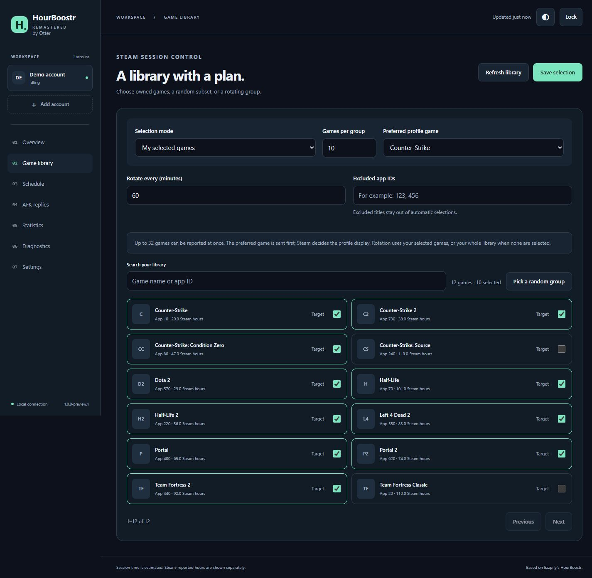
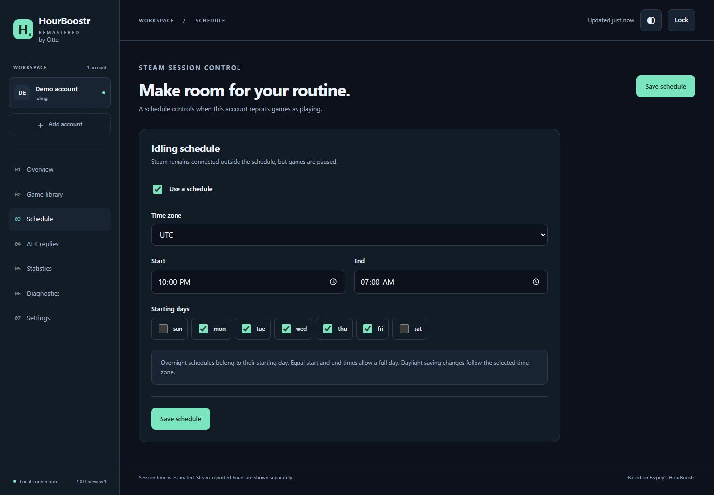
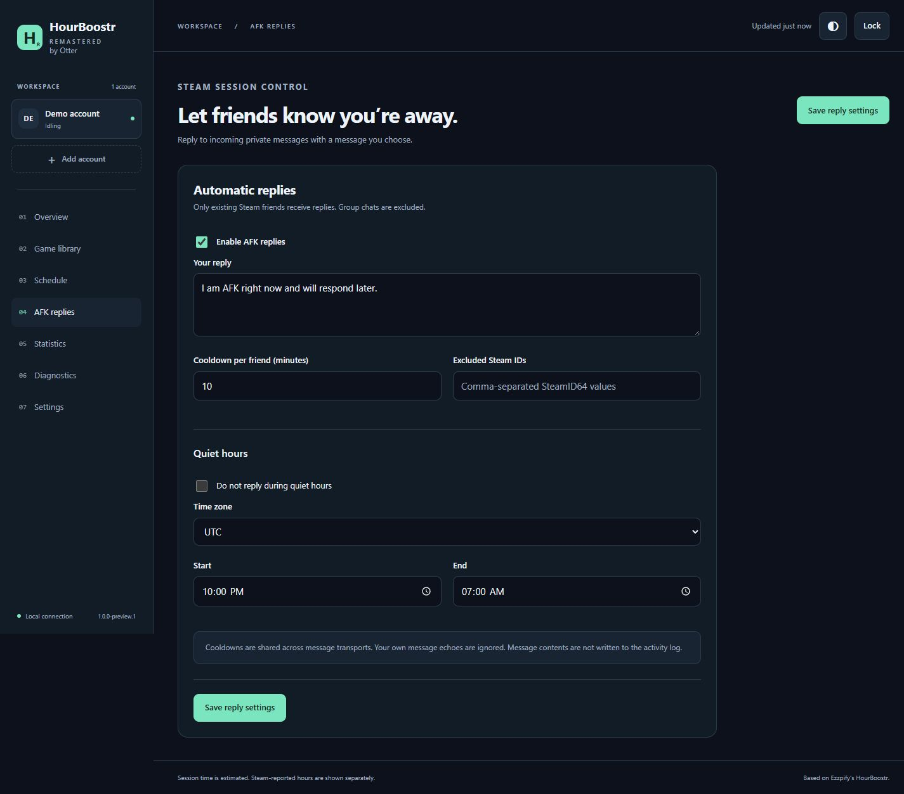
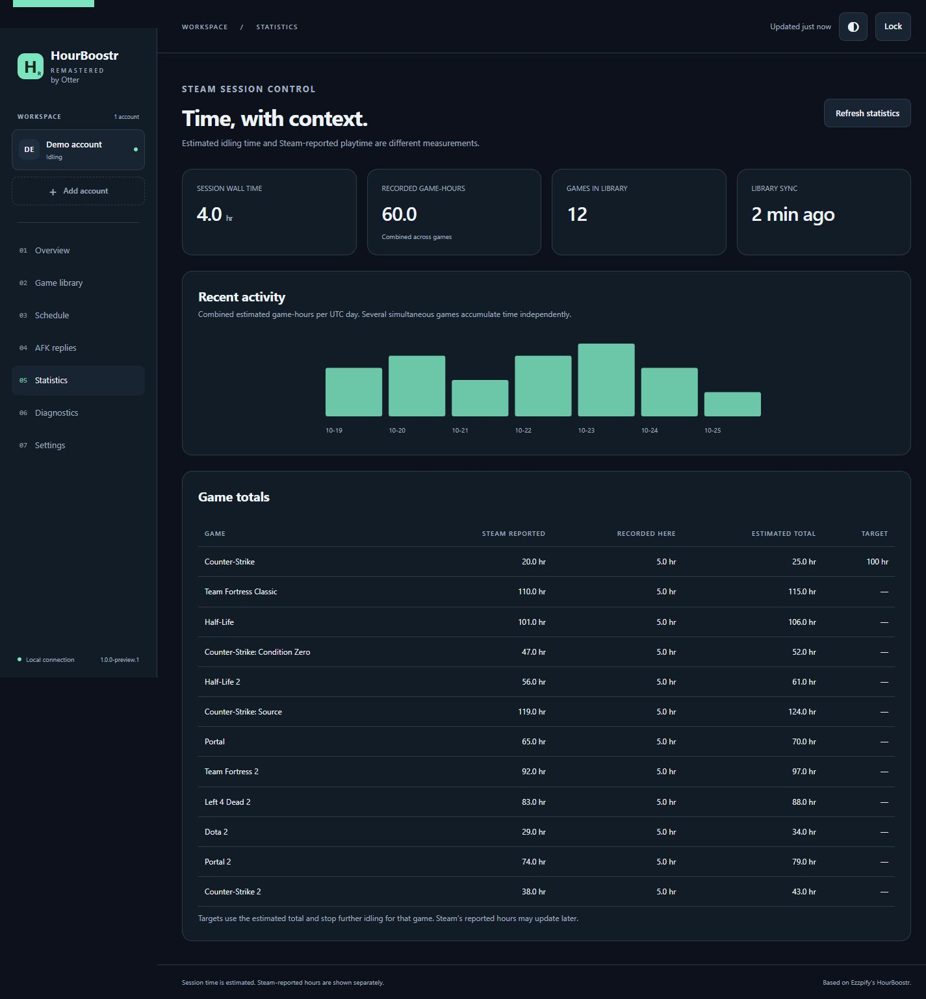

# Complete tutorial

[Project home](../README.md) · [Downloads](https://github.com/otter-supremacy/HourBoostr-Remastered/releases) · [Troubleshooting](TROUBLESHOOTING.md) · [Credits](../CREDITS.md)

HourBoostr Remastered by Otter reports selected owned games as playing through a separate Steam session. You do not install or run the games themselves. Steam decides credited playtime and profile display. This preview does not farm trading cards.

## Choose an installation

| Your system | Package | Interface |
| --- | --- | --- |
| Windows x64 | `HourBoostr-Remastered-1.0.0-preview.1-win-x64.zip` | Desktop window, tray, and browser dashboard |
| Linux x64 / x86-64 VPS | `HourBoostr-Remastered-1.0.0-preview.1-linux-x64.zip` | Browser dashboard over SSH, plus CLI |
| Linux ARM64 / aarch64 | `HourBoostr-Remastered-1.0.0-preview.1-linux-arm64.zip` | Same Linux workflow; native ARM64 execution not yet verified |

Download the ZIP and matching `.zip.sha256` from the same [release](https://github.com/otter-supremacy/HourBoostr-Remastered/releases/tag/v1.0.0-preview.1). GitHub's **Source code** archives contain source; they are not the ready-to-run application. The published packages include .NET, so a separate .NET runtime is not needed. Native operating-system dependencies still apply.

Use an account you own. The account must own each selected game. Start live testing with a separate account instead of a Steam account already idling on another machine.

## Windows desktop

1. Download the Windows ZIP and checksum.
2. Compare the ZIP's SHA-256 with the text in the checksum file:

   ```powershell
   Get-FileHash .\HourBoostr-Remastered-1.0.0-preview.1-win-x64.zip -Algorithm SHA256
   Get-Content .\HourBoostr-Remastered-1.0.0-preview.1-win-x64.zip.sha256
   ```

3. Use **Extract All** into a permanent folder, for example `C:\Apps\HourBoostr-Remastered`. Keep all extracted files together.
4. Open `HourBoostr.Desktop.exe`. It starts a hidden local Steam worker and opens the embedded dashboard. `HourBoostr.Remastered.exe` must remain beside it.
5. The desktop dashboard uses [Microsoft Edge WebView2 Runtime](https://developer.microsoft.com/en-us/microsoft-edge/webview2/). If it is unavailable, install it from Microsoft; the app also offers a browser fallback.
6. Follow [Steam sign-in](#steam-sign-in), then [choose games](#choose-games).

Account data defaults to `%LOCALAPPDATA%\HourBoostrRemastered`, outside the installation folder. A custom installation can be launched with:

```powershell
.\HourBoostr.Desktop.exe --data-dir C:\HourBoostrData --port 3241
```

### Windows startup and tray

1. Open **Settings → Windows startup and tray**.
2. Enable **Start with Windows**. The app registers a current-user sign-in entry using this executable, data directory, port, and `--start-minimized`.
3. Enable **Close window to tray** if you want the close button to keep the app running. This is enabled by default. The minimize button and **Minimize to tray** also hide the window.
4. Double-click the tray icon to restore the dashboard. The icon can be inside Windows' hidden-icons menu.
5. Select **Exit** from the tray menu to stop the application and its Steam workers. A hidden window alone does not mean the app has exited.

Startup occurs when this Windows user signs in, not before Windows sign-in. No administrator account or stored Windows password is required. After moving the installation, disable and re-enable startup so the stored path is updated. Use either the built-in startup option or the scheduled-task installer, not both for one installation.

### Windows without the desktop window

1. Start the worker in PowerShell:

   ```powershell
   .\HourBoostr.Remastered.exe serve
   ```

2. In a second PowerShell window, open and pair the browser:

   ```powershell
   .\HourBoostr.Remastered.exe open
   ```

Keep the worker running. Use the same `--data-dir` and `--port` with every command. For a console-only startup task, see `scripts/install-windows-startup.ps1`; the desktop's startup switch is the simpler option for tray use.

## Steam sign-in

1. Select **Add account** and give it a local label. Labels are for identifying accounts inside this installation.
2. Select **Password & Steam Guard**.
3. Enter the Steam **account login name**, which may differ from the public profile name, and password directly in the app.
4. Submit the requested Steam Guard code in the app, or approve the mobile sign-in if Steam requests it.
5. Wait for the library to load. A saved refresh session can reconnect after restart without entering the password again.

The app does not save your password or Guard codes. Windows session files use current-user DPAPI; Linux files use owner-only permissions and are not encrypted at rest. Treat session files and backups as credentials.

**QR option:** choose **Scan QR code → Create sign-in QR code**, scan it using Steam Mobile, and approve the sign-in. QR rendering is implemented, but a completed live scan/approval test remains pending for this preview. Password/Guard is the verified sign-in path.

Never put credentials or QR challenges in GitHub issues or public screenshots. If sign-in is rejected, use the [troubleshooting guide](TROUBLESHOOTING.md#steam-login-does-not-work) before trying again.

## Choose games



1. Open **Game library** and select **Refresh library** if needed.
2. Choose a selection mode:

   | Mode | Behavior |
   | --- | --- |
   | My selected games | Reports the owned games you check |
   | Random owned games | Chooses a group of eligible owned games; keeps it until you ask for another group or restart the worker |
   | Rotate game groups | Changes groups at the configured interval; uses selected games, or the owned library if none are selected |

3. Search by game name or app ID. Add exclusions when a game should stay out of automatic choices.
4. Set **Games per group** when using random or rotation modes. At most 32 games can be reported together.
5. Choose a **Preferred profile game** if desired. The app sends it first, but Steam controls what appears publicly.
6. Select **Save selection**. Unsaved edits do not change the running selection.
7. Return to **Overview** and check the reported games and connection details. Use **Pause** or **Resume** for that account.

To keep Counter-Strike 1.6 and Dota 2 in a specific ten-game selection, use manual mode, check **Counter-Strike** (app `10`), **Dota 2** (app `570`), and eight other owned games. Set Counter-Strike as the preferred game and save. Random mode does not promise to include Dota 2 in every group.

### Schedules and hour targets



1. Open **Schedule**, enable the schedule, and choose a time zone.
2. Choose the start time, end time, and days, then select **Save schedule**. An overnight window belongs to its starting day.
3. In **Game library**, choose **Target** next to a game to set an estimated total-hour target. Leave it blank to remove the target.
4. The app excludes a game from selection after its estimate reaches the target. This estimate is not a guarantee of Steam-credited hours.

Disabling the schedule removes the time restriction. A schedule pause stops game reporting; the connected account can still receive friend/AFK events when those features are enabled.

## AFK replies and incoming friend requests



### AFK replies

1. Open **AFK replies** and enable replies.
2. Enter the reply text, cooldown, optional excluded Steam IDs, and quiet hours.
3. Select **Save replies**.
4. Ask an existing Steam friend to send the account a private message. Delivery is tested by receiving the actual reply, not merely by enabling the switch.

Replies are limited to incoming private messages from existing friends. The app suppresses self-messages, local echoes, and repeats inside the cooldown. It does not read chat history or log message bodies.

### Friend requests

1. Open **Settings → Account settings**.
2. Enable **Automatically accept incoming friend requests** and select **Save account**.
3. The app processes pending and newly received individual requests. It rechecks the relationship before accepting and limits rapid/duplicate attempts.
4. Disable the checkbox and save to stop acceptance. New profiles default to off.

Blocked users, groups, existing friends, and outgoing requests do not qualify. A successful Steam response appears in activity logs without the other user's identity. Live acceptance still needs an incoming-request test in this preview. See [friend-request details](FRIEND-REQUESTS.md).

## Configure the AI chatbot

Create your key under **API Keys → Create API Key** in the Groq Console. Use a key from your own Groq project. For Qwen, you can create a separate key and select it during setup. Keep keys out of issues, screenshots, chat, and shell command arguments. [Groq Console API keys](https://console.groq.com/keys)

### Self-hosted HourBoostr

Use a build that includes **Groq connection** in **AFK replies**. Run the key commands on the machine hosting HourBoostr, under the same operating-system user and with the same `--data-dir` as the worker. Use the data paths below only if they match your install. Omit the option if the worker uses the default.

1. Save your GPT key. Enter it at the masked prompt. Run the optional second line to configure Qwen.

   **Windows (PowerShell 7+)**

   ```powershell
   Read-Host "Groq GPT key" -MaskInput | .\HourBoostr.Remastered.exe ai-key --data-dir 'C:\HourBoostrData'
   Read-Host "Groq Qwen key" -MaskInput | .\HourBoostr.Remastered.exe ai-qwen-key --data-dir 'C:\HourBoostrData'
   ```

   **Linux (Bash)**

   ```bash
   (read -rsp 'Groq GPT key: ' key; printf '\n' >&2; printf '%s\n' "$key" | ./HourBoostr.Remastered ai-key --data-dir "$HOME/hourboostr-data")
   (read -rsp 'Groq Qwen key: ' key; printf '\n' >&2; printf '%s\n' "$key" | ./HourBoostr.Remastered ai-qwen-key --data-dir "$HOME/hourboostr-data")
   ```

2. Select the Steam account, open **AFK replies**, and check **Groq connection**. Enable private or group replies first, then turn on the corresponding **Use AI** option.
3. Edit the GPT and Qwen prompts if desired, set the per-model daily request limit and cooldown, then select **Save reply settings**. GPT handles normal chat. HourBoostr can route hostile messages to Qwen within that conversation.
4. Under **Groq connection**, set **Start preview with** to **Automatic**, **GPT-OSS 20B**, or **Qwen 3.8 27B** and enter a sample incoming message. Select **Generate preview**. A preview consumes an AI request and sends no Steam message.
5. To remove a saved key, run `ai-key --remove` or `ai-qwen-key --remove` with the same executable and data directory.

### Hosted Members

1. Sign in to the [Members dashboard](https://hourboostr.pages.dev/dashboard) and open **Account → Optional Groq replies**.
2. Select **GPT**, paste your own key in **Your Groq API key**, and select **Save key**. To configure Qwen, select **Qwen** and repeat with your Qwen key. Use **Remove key** to delete the key for the selected model.
3. Enter your preferred GPT and Qwen reply styles. Turn on the private or group reply option and its matching **Use Groq** checkbox, then select **Save chat settings**.
4. Enter a sample under **Optional Groq replies** and select **Preview AI reply**. The public site currently simulates Steam. Previews call Groq using your saved key. Sending automatic Steam replies requires a live Steam worker.

When AI replies are enabled, eligible message text goes to Groq. The app tracks request budgets per model and resets them at midnight UTC. Groq also applies its own service limits. [Groq rate limits](https://console.groq.com/docs/rate-limits)

## Statistics and diagnostics



- **Session wall time** is elapsed idling time for this worker session.
- **Recorded game-hours** combine per-game estimates. Ten games reported for one hour can contribute ten estimated game-hours while only one wall-clock hour passes.
- **Steam reported** is returned by Steam's library query; it can update later than the local counters.
- **Diagnostics** downloads a report that excludes login names, Steam IDs, passwords, session tokens, QR challenges, and chat content.

Use `HourBoostr.Remastered doctor --live` for connection diagnostics, or `doctor` for environment-only diagnostics. Add the same `--data-dir` and `--port` as the running installation.

## Linux and VPS

The Linux packages build successfully. Hosted Linux builds/tests and container startup/API/data-persistence checks passed. Native Linux ZIP execution, the user service, ARM64 execution, and live Steam use on Linux still require verification. This guide describes the supplied installation path. The separately patched classic VPS app is not evidence that this new runtime has passed native Linux testing.

### Install and run

1. Connect to your VPS using its existing SSH account. Use an ordinary user, not a root login for the application.
2. Download the x64 or ARM64 ZIP and `.sha256` file from the release. Choose the architecture reported by `uname -m`: `x86_64` means x64; `aarch64` means ARM64.
3. Verify and extract. Example for x64, from the directory containing the downloaded files:

   ```sh
   sha256sum -c HourBoostr-Remastered-1.0.0-preview.1-linux-x64.zip.sha256
   mkdir -p "$HOME/apps/hourboostr-remastered" "$HOME/.local/share/HourBoostrRemastered"
   unzip HourBoostr-Remastered-1.0.0-preview.1-linux-x64.zip -d "$HOME/apps/hourboostr-remastered"
   chmod 700 "$HOME/.local/share/HourBoostrRemastered"
   chmod u+x "$HOME/apps/hourboostr-remastered/HourBoostr.Remastered"
   cd "$HOME/apps/hourboostr-remastered"
   ./HourBoostr.Remastered serve --data-dir "$HOME/.local/share/HourBoostrRemastered"
   ```

4. Keep the application terminal open for initial setup. In a second local terminal on your computer, create an SSH tunnel:

   ```sh
   ssh -L 3241:127.0.0.1:3241 YOUR_SSH_USER@YOUR_VPS_IP
   ```

5. In that SSH session, obtain the private dashboard pairing key:

   ```sh
   "$HOME/apps/hourboostr-remastered/HourBoostr.Remastered" dashboard-key --data-dir "$HOME/.local/share/HourBoostrRemastered"
   ```

6. On your computer, open `http://127.0.0.1:3241`, enter that key locally, and follow the sign-in/game-selection steps above. Do not share the key. Keep the tunnel open while using the dashboard.

If local port 3241 is occupied, use `ssh -L 3245:127.0.0.1:3241 ...` and browse to `http://127.0.0.1:3245`. The server can keep its original port. The tunnel avoids opening the dashboard port publicly.

### Linux startup and recovery

1. Stop the foreground application with Ctrl+C after initial setup.
2. Install the supplied user service:

   ```sh
   bash "$HOME/apps/hourboostr-remastered/scripts/install-linux-service.sh" \
     "$HOME/apps/hourboostr-remastered" "$HOME/.local/share/HourBoostrRemastered"
   systemctl --user status hourboostr-remastered.service
   ```

3. To keep this user's service running without an interactive login, enable lingering using your administrator account:

   ```sh
   sudo loginctl enable-linger "$USER"
   ```

4. Check logs and restart when needed:

   ```sh
   journalctl --user -u hourboostr-remastered.service -n 50 --no-pager
   systemctl --user restart hourboostr-remastered.service
   ```

The service restarts failed processes. The app handles ordinary Steam reconnects; rejected credentials pause sign-in attempts. Hosting availability, free-tier eligibility, VM reclamation, and machine uptime remain the hosting provider's responsibility. This software creates no cloud resources and promises no permanently free VPS.

## Docker on Linux

Container build, dashboard startup, authenticated API access, and data persistence across container replacement passed in hosted Linux CI. Live Steam login/idling inside Docker remains unverified for this preview.

1. Clone the repository and enter its directory.
2. Run `docker compose up --build -d`. The supplied Compose file uses Linux host networking and a persistent named data volume.
3. Retrieve the private pairing key:

   ```sh
   docker compose exec hourboostr dotnet HourBoostr.Remastered.dll dashboard-key
   ```

4. Use the loopback dashboard locally or an SSH tunnel as described above. Pair the browser and sign in.
5. Inspect `docker compose logs --tail=50 hourboostr`. Use `docker compose restart hourboostr` to restart.
6. Use `docker compose down` to stop/remove the container while preserving its named data volume. Do not add `-v` if you want to keep saved sessions and statistics.

The example targets Linux host networking. Docker Desktop networking differs and is not covered by this tested configuration.

## Build from source

1. Install Git, Python 3 for packaging/API test scripts, and the [.NET 10 SDK](https://dotnet.microsoft.com/download/dotnet/10.0).
2. Clone and build:

   ```sh
   git clone https://github.com/otter-supremacy/HourBoostr-Remastered.git
   cd HourBoostr-Remastered
   dotnet restore HourBoostr.Remastered.slnx --locked-mode
   dotnet build HourBoostr.Remastered.slnx -c Release --no-restore
   dotnet test HourBoostr.Remastered.slnx -c Release --no-restore
   ```

3. Start the browser dashboard:

   ```sh
   dotnet run --project src/HourBoostr.Remastered -c Release --no-build -- serve
   ```

4. In a second terminal, run `dotnet run --project src/HourBoostr.Remastered -c Release --no-build -- open`.
5. To create a Windows package using PowerShell, run `./scripts/publish.ps1 -Runtime win-x64`. Replace the runtime with `linux-x64` or `linux-arm64` for those packages. Outputs go to `artifacts/releases/`.

The Windows desktop launcher expects published sibling files. Use the packaged `HourBoostr.Desktop.exe` rather than running the desktop project directly without the worker files. See [TESTING.md](TESTING.md) for integration and live tests.

## Updates, backups, and moving machines

1. Back up the data directory while the app is stopped. Treat that backup as private because it includes saved sessions.
2. Exit the Windows desktop launcher or stop the Linux service before replacing an installation. A running launcher/service can otherwise restart the worker.
3. Download the appropriate new ZIP, verify its checksum, and extract into a separate release directory. Keep data outside release directories.
4. Start the new version using the same data directory and port. Re-enable Windows startup if the executable path changed.
5. Check the library, game selection, and statistics. Keep the previous release until the new version is verified.

The CLI also supports verified update staging and managed apply/rollback; see the [README update commands](../README.md#updates). Configure `otter-supremacy/HourBoostr-Remastered` as the release source for stable-release checks. Preview releases are downloaded directly; the stable-release endpoint excludes prereleases.

Windows DPAPI sessions are tied to the Windows user/machine. On a new machine, sign in again rather than copying session files and expecting them to decrypt. For migration from classic HourBoostr, keep the old install/data as a backup, sign into a new remaster profile, and manually choose games and settings. Classic `Settings.json` and refresh tokens are not a supported import format.

## Stop or uninstall

1. Disable **Start with Windows** before moving or removing a Windows desktop installation. Exit from its tray menu.
2. For a Linux user-service install, run `bash scripts/uninstall-linux-service.sh` from the release directory, then confirm the service is stopped. The supplied removal script preserves account data.
3. For a console-only process, press Ctrl+C or use the worker's `stop` command with the correct data directory and port.
4. Keep the data directory if you want your settings/statistics later. **Forget saved session** removes a session from this installation; it does not revoke other Steam devices. Use Steam's own account settings if you need to revoke other sessions.

## References and verification

- [Feature matrix](FEATURE-MATRIX.md): implemented features and evidence/remaining tests.
- [Security](../SECURITY.md): credentials, local access, and reporting.
- [Credits and upstream lineage](../CREDITS.md): Ezzpify, rpges, Kasp42, and dependencies.
- [Original HourBoostr README](../legacy/README.md): the preserved original project documentation.
